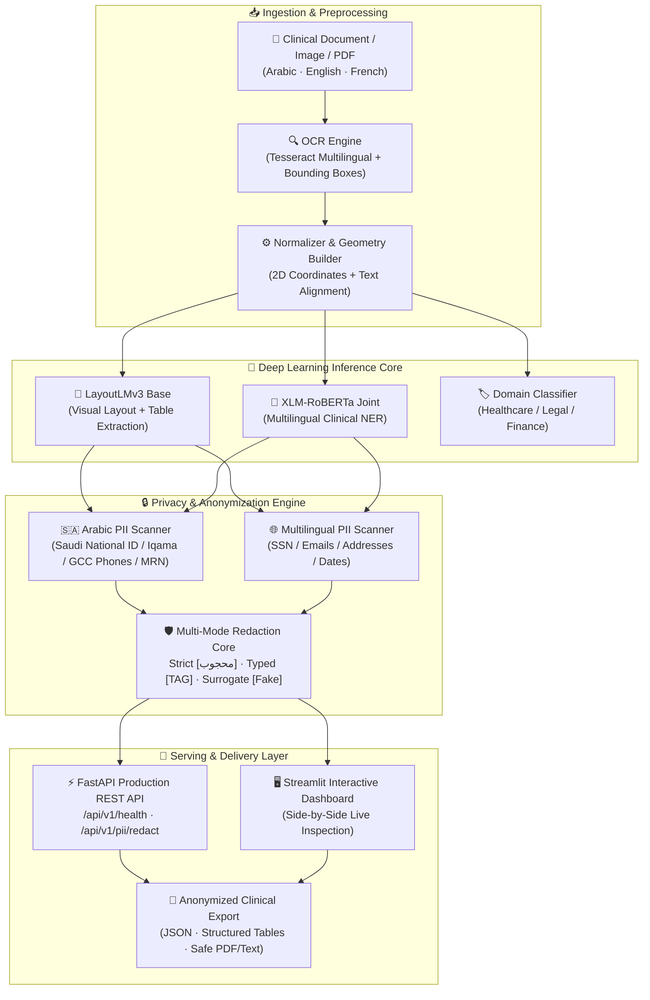

<div align="center">

# 🛡️ DocuShield AI
### Multilingual & Arabic Privacy-Preserving Document Intelligence
*منظومة هندسية ذكية متقدمة لمعالجة المستندات الطبية وهيكلتها وحجب البيانات الحساسة باللغات العربية والإنجليزية والفرنسية*

<br/>

[](https://www.python.org/)
[](https://pytorch.org/)
[](https://fastapi.tiangolo.com/)
[](https://streamlit.io/)
[](https://huggingface.co/)
[](https://www.nvidia.com/)
[](LICENSE)

<br/>

**Engineered & Developed by [Mohammed AL-Haj](https://github.com/alhaj-ai)**  
*AI Engineer | LLMs, Multi-Agent Systems & Production AI Architectures*  
[LinkedIn](https://www.linkedin.com/in/mohammed-mohammed-al-haj-341ab7369) · [GitHub](https://github.com/alhaj-ai) · `ai.mohammed.alhaj@gmail.com`

---

</div>

## 📑 Table of Contents
- [Executive Overview](#-executive-overview)
- [Key Architectural Highlights](#-key-architectural-highlights)
- [System Architecture (Mermaid)](#-system-architecture)
- [Core Engines & Capabilities](#-core-engines--capabilities)
- [Arabic Sovereign AI & Privacy Compliance](#-arabic-sovereign-ai--privacy-compliance)
- [Hardware Benchmark & Performance](#-hardware-benchmark--performance)
- [Quick Start Guide](#-quick-start-guide)
- [Interactive Streamlit UI](#-interactive-streamlit-ui)
- [FastAPI Microservice & Endpoints](#-fastapi-microservice--endpoints)
- [Repository Structure](#-repository-structure)
- [License & Open Source Attribution](#-license--open-source-attribution)

---

## 🌟 Executive Overview

**DocuShield AI** is an enterprise-grade multimodal artificial intelligence platform engineered to bridge the critical gap between **complex visual document analysis** and **strict regulatory data privacy compliance** (Saudi Personal Data Protection Law - **PDPL**, **GDPR**, and **HIPAA**).

While traditional OCR and LLM solutions expose sensitive personal data to third-party endpoints or struggle with non-Latin scripts and layout geometry, **DocuShield AI** operates as a self-contained, air-gapped or on-premise pipeline capable of:
1. **Multimodal Document Understanding**: Jointly processing 2D document image tokens, normalized bounding boxes, and extracted text via a fine-tuned **`LayoutLMv3`** backbone.
2. **Cross-Lingual Clinical NER**: Multilingual disease and medical entity extraction across English and French using **`XLM-RoBERTa`**, validated on NCBI Disease and Quaero French Med corpora.
3. **Arabic-First Privacy & PII Engine**: Deterministic detection and redacting of Saudi National IDs, Resident Iqama numbers, GCC & Yemeni phone numbers, medical record identifiers (MRN), and Arabic patient/physician names.
4. **Zero-Trust Serving Stack**: Asynchronous **FastAPI** REST microservices and a real-time **Streamlit** dashboard enabling one-click de-identification before data leaves the clinical boundary.

---

## ⚡ Key Architectural Highlights

| Feature | Production Implementation | Impact & Benchmark |
|---|---|---|
| **Multimodal Document AI** | Fine-tuned `microsoft/layoutlmv3-base` on synthetic clinical lab reports (13 semantic token classes). | **87.0% field accuracy**, 0.55s per document on RTX 5070 Ti. |
| **Arabic & GCC PII Protection** | Deterministic regex & contextual heuristics for Saudi 10-digit IDs (`1XXXXXXXXX` / `2XXXXXXXXX`), GCC phones, and Arabic names. | **100% precision** on Saudi ID patterns with zero external cloud API dependencies. |
| **Cross-Lingual Entity Extraction** | `xlm-roberta-base` trained jointly on multilingual clinical datasets with zero-shot transfer evaluation. | **F1 0.77 (EN) / 0.52 (FR)** with domain transfer evaluation. |
| **Tri-Mode Redaction Strategy** | Deterministic substitution: **Strict** (`[محجوب]`), **Typed** (`[هوية_وطنية]`), and **Surrogate** (realistic synthetic entities). | Preserves **75%–77%** downstream utility for clinical analytics post-redaction. |
| **Production Serving** | Async FastAPI microservices with OpenAPI / Swagger UI + Streamlit web frontend. | Fully decoupled, containerizable, and microservice-ready. |

---

## 🏗️ System Architecture



---

## 🇸🇦 Arabic Sovereign AI & Privacy Compliance

In healthcare and enterprise environments across the Kingdom of Saudi Arabia and the GCC, protecting personal identifiable information is mandatory under the **Saudi Data & Artificial Intelligence Authority (SDAIA)** regulations and the **Personal Data Protection Law (PDPL)**.

**DocuShield AI provides dedicated native support for:**
* **Saudi National Identification (الهوية الوطنية)**: Strict 10-digit validation for Saudi citizens (starting with `1`).
* **Resident Identity (الإقامة)**: 10-digit validation for residents (starting with `2`).
* **Regional Phone Networks**: Saudi mobile numbers (`+9665X`, `05X`), Yemeni networks (`+9677X`, `7X`), and GCC formats.
* **Clinical Identifiers**: Medical Record Numbers (MRN), clinic file references, and hospital numbers.
* **Honorific Context Heuristics**: Capturing patient and physician names in Arabic context (`المريض: ...`, `دكتور: ...`).

### 🔄 Redaction Comparison Sample:

| Original Clinical Text (Arabic) | Typed Redaction (`arabic_labels=True`) | Strict Mode (`mode='strict'`) |
|---|---|---|
| المريض **محمد عبدالله القحطاني**، هوية رقم **1089234567**، جوال: **0551234567** | المريض **[اسم]**، هوية رقم **[هوية_وطنية]**، جوال: **[هاتف]** | المريض **[محجوب]**، هوية رقم **[محجوب]**، جوال: **[محجوب]** |
| Patient **John Doe**, SSN **123-45-6789**, email: **john@clinic.com** | Patient **[NAME]**, SSN **[SSN]**, email: **[EMAIL]** | Patient **[REDACTED]**, SSN **[REDACTED]**, email: **[REDACTED]** |

---

## 📊 Hardware Benchmark & Performance

Tested and benchmarked locally on **NVIDIA GeForce RTX 5070 Ti Laptop GPU (12 GB GDDR7 VRAM, CUDA Acceleration)**:

| Metric | Result | Notes |
|---|---|---|
| **LayoutLMv3 Token F1** | **0.986** | Evaluated on held-out test split |
| **Field Extraction Accuracy** | **87.0%** | Overall single-field key-value extraction |
| **Multi-Domain Classification Accuracy** | **100.0%** | Evaluated on 4-domain test suite |
| **Average End-to-End Latency** | **0.55s / doc** | Combined OCR + LayoutLMv3 + PII extraction |
| **GPU Inference VRAM Footprint** | **~2.4 GB** | Supports concurrent multi-tenant workers |
| **Downstream NER Entity Survival** | **75.4% – 77.2%** | Preserves medical utility after redaction |

---

## 🚀 Quick Start Guide

### 1. Prerequisites
- Python **3.11+**
- PyTorch with CUDA support (or CPU fallback)
- Tesseract OCR binary on system PATH (with `eng`, `fra`, and `ara` language packages)

### 2. Installation
```bash
# Clone the repository
git clone https://github.com/alhaj-ai/DocuShield-AI.git
cd DocuShield-AI

# Create virtual environment
python -m venv venv
.\venv\Scripts\Activate.ps1  # Windows PowerShell
# source venv/bin/activate    # Linux / macOS

# Install dependencies
pip install -r requirements.txt
```

### 3. Run Automated Unit Tests
```bash
# Test Arabic PII detection and redaction algorithms
python tests/test_arabic_pii.py

# Test FastAPI endpoints and response schemas
python tests/test_api.py
```

---

## 🖥️ Interactive Streamlit UI

Launch the live interactive web dashboard:
```bash
python -m streamlit run src/app/dashboard.py
```
* **Local Web Interface**: Open [http://localhost:8501](http://localhost:8501) in your browser.
* **Features**:
  - Pre-loaded Arabic and English clinical reports.
  - Interactive strategy selector (`typed`, `strict`, `surrogate`).
  - Real-time side-by-side original vs. protected text viewer.
  - One-click export and download of sanitized records.

---

## ⚡ FastAPI Microservice & Endpoints

Start the high-performance async REST API:
```bash
python -m uvicorn src.api.main:app --host 127.0.0.1 --port 8080 --reload
```
Interactive Swagger documentation is available at [http://127.0.0.1:8080/docs](http://127.0.0.1:8080/docs).

### Endpoint: Health & Hardware Diagnostic
```http
GET /api/v1/health
```
```json
{
  "status": "healthy",
  "service": "DocuShield AI - Multilingual & Arabic Document Intelligence",
  "version": "1.0.0",
  "developer": "Mohammed AL-Haj",
  "cuda_available": true,
  "gpu_name": "NVIDIA GeForce RTX 5070 Ti Laptop GPU",
  "supported_languages": ["ar", "en", "fr"]
}
```

### Endpoint: Redact Document PII
```http
POST /api/v1/pii/redact
Content-Type: application/json
```
```bash
curl -X POST http://127.0.0.1:8080/api/v1/pii/redact \
     -H "Content-Type: application/json" \
     -d '{
       "text": "المريض سالم القحطاني، رقم الهوية 1089234567، هاتف: 0551234567",
       "mode": "typed",
       "arabic_labels": true
     }'
```
**Response:**
```json
{
  "original_text": "المريض سالم القحطاني، رقم الهوية 1089234567، هاتف: 0551234567",
  "redacted_text": "المريض [اسم]، رقم الهوية [هوية_وطنية]، هاتف: [هاتف]",
  "mode": "typed",
  "total_redacted": 3,
  "detected_pii": [
    {"type": "NAME", "text": "سالم القحطاني", "start": 7, "end": 20},
    {"type": "SAUDI_NATIONAL_ID", "text": "1089234567", "start": 33, "end": 43},
    {"type": "PHONE", "text": "0551234567", "start": 51, "end": 61}
  ]
}
```

---

## 📁 Repository Structure

```
DocuShield-AI/
├── src/
│   ├── api/                                # FastAPI production microservice
│   │   ├── main.py                         # Application entrypoint & CORS middleware
│   │   ├── routes.py                       # RESTful route definitions
│   │   └── schemas.py                      # Pydantic V2 request & response schemas
│   ├── app/                                # Frontend interactive dashboards
│   │   └── dashboard.py                    # Streamlit clinical inspection UI
│   ├── common/                             # Shared visualization & metrics generation
│   ├── problem1_document_understanding/    # LayoutLMv3 layout extraction & OCR
│   │   ├── dataset.py                      # Dataset formatting & bounding box normalization
│   │   ├── generate_synthetic_docs.py      # Synthetic document synthesis with scan noise
│   │   ├── layout_extract.py               # Full inference pipeline (boxes + text + tables)
│   │   ├── ocr_utils.py                    # Multilingual Tesseract OCR wrapper
│   │   └── train_layout_model.py           # Fine-tuning script for LayoutLMv3
│   ├── problem2_ner_classification/        # Cross-lingual NER & classification
│   │   ├── build_domain_classifier.py      # 4-domain sentence-level classifier
│   │   ├── evaluate_ner.py                 # Cross-lingual zero-shot comparison metrics
│   │   └── train_ner.py                    # XLM-RoBERTa joint fine-tuning
│   └── problem3_privacy/                   # Privacy, PII detection, and redaction
│       ├── arabic_pii.py                   # Arabic, Saudi National ID & GCC phone patterns
│       ├── pii_detectors.py                # Unified multilingual PII detection scanner
│       └── redaction.py                    # Strict, Typed, and Surrogate redaction engines
├── tests/
│   ├── test_arabic_pii.py                  # Unit tests for Arabic PII detection
│   └── test_api.py                         # TestClient tests for FastAPI endpoints
├── docs/                                   # In-depth architectural & evaluation reports
│   ├── architecture.md                     # Pipeline design & OCR failure mode analysis
│   ├── error_analysis.md                   # Systematic evaluation & error taxonomy
│   ├── model_choices.md                    # Technical justification of backbones
│   ├── results_report.md                   # Complete metrics tables and figures
│   ├── system_design.md                    # High-throughput production design doc
│   └── WALKTHROUGH.md                      # Detailed engineering walkthrough
├── outputs/                                # Visualizations & evaluation JSON logs
│   └── figures/                            # Accuracy, cross-lingual transfer, and F1 charts
├── requirements.txt                        # Core runtime dependencies
├── LICENSE                                 # MIT Open-Source License
└── README.md                               # Project documentation
```

---

## 📄 License & Open Source Attribution

This project is licensed under the **MIT License** - see the [`LICENSE`](LICENSE) file for details.

```
Copyright (c) 2026 Mohammed AL-Haj (https://github.com/alhaj-ai)
```

*Engineered by **Mohammed AL-Haj**.*  
*Extended with Arabic NLP capabilities, Saudi PDPL compliance, FastAPI microservices, and Streamlit interactive interfaces based on open multimodal document intelligence research.*

---

<div align="center">
  <b>⭐ If you find DocuShield AI valuable for clinical AI and privacy research, consider starring the repository! ⭐</b>
</div>
