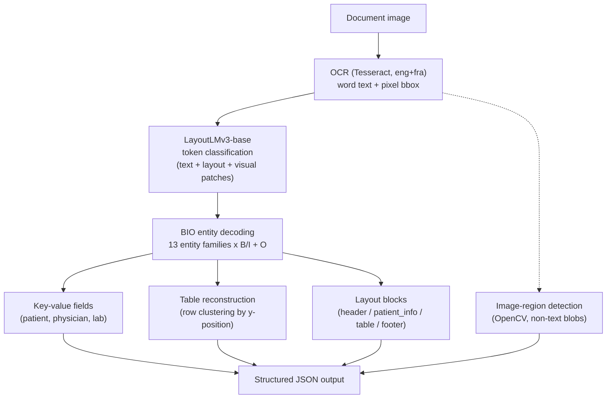

# Problem 1 — Multimodal Document Understanding: Architecture

Domain: **medical lab reports** (English + French). Code: [src/problem1_document_understanding/](../src/problem1_document_understanding/).

## Why synthetic documents

No public dataset pairs scanned medical lab reports with layout + key-value ground truth (FUNSD is generic forms, RVL-CDIP is classification-only). The spec explicitly allows "synthetic documents using real templates," so [generate_synthetic_docs.py](../src/problem1_document_understanding/generate_synthetic_docs.py) renders lab reports (header/logo, patient-info block, results table, physician footer) from a realistic template using Faker for names/addresses/dates, with exact pixel ground truth for every field and table cell. 30% of documents get scan-like noise (±3° rotation, Gaussian blur, JPEG recompression) to emulate real scanning. This also means labels for LayoutLMv3 training are auto-generated (no manual annotation): each OCR word is matched to the ground-truth span whose box contains its center ([labels.py](../src/problem1_document_understanding/labels.py)).

160 documents generated for training, 80 held out for evaluation, balanced EN/FR.

## Pipeline

**Model choice — LayoutLMv3 over Donut:** LayoutLMv3 jointly embeds OCR text, 2D layout position, and visual patches into one token-classification transformer, which fits this task's structured, template-consistent key-value + table extraction well and grounds predictions in explicit bounding boxes. Donut is OCR-free and more flexible for free-form documents, but its generative decoding is harder to constrain to a fixed schema and more expensive to train — a worse fit for lab-report-style structured extraction. LayoutLMv3-base fits comfortably in 8GB VRAM at batch size 4 with fp16.

**Label scheme:** 13 entity families (`LABNAME`, `LABADDR`, `PATIENT_NAME`, `DOB`, `PATIENT_ID`, `REPORT_DATE`, `PHYSICIAN_NAME`, `PHYSICIAN_ID`, `TEST_NAME`, `VALUE`, `UNIT`, `REF_RANGE`, `FLAG`) × B/I + `O` = 27 token labels ([labels.py](../src/problem1_document_understanding/labels.py)).

**Post-processing:** BIO spans are decoded into entities, then (a) single-value families become key-value fields, (b) table-column families are clustered into rows by y-coordinate proximity and re-assembled into a `{columns, rows}` table, (c) entity families are grouped into coarse layout blocks (header/patient_info/table/footer), and (d) an OpenCV pass finds non-text rectangular regions (the logo) that the token classifier can't see, reported as `image` blocks — together satisfying the "segment into text blocks, tables, images, headers" requirement.

## Training

Fine-tuned `microsoft/layoutlmv3-base` for 15 epochs, batch size 4, lr 2e-5, fp16, on an RTX 5070 Laptop GPU (8GB VRAM). Wall time: **503.9s (~8.4 min)**.

Token-level held-out metrics: **precision 0.985, recall 0.987, F1 0.986, accuracy 0.987**.

## Extraction Evaluation (80 held-out documents)

Run via [evaluate_extraction.py](../src/problem1_document_understanding/evaluate_extraction.py); full results in `outputs/problem1_eval_summary.json` / `problem1_eval_full.json`, examples in `outputs/problem1_eval_examples.json`.

| Metric | Value |
|---|---|
| Overall field exact-match accuracy | 87.0% |
| Table cell-level accuracy | 72.2% |
| Table full-row exact-match | 23.5% |
| Avg. processing time / document | 0.55s |
| English field accuracy | 94.4% |
| French field accuracy | 79.7% |
| Clean-scan field accuracy | 92.0% |
| Noisy-scan (augmented) field accuracy | 71.1% |

## Bottlenecks, failure modes, and optimization strategies

1. **Scan noise is the single biggest accuracy driver.** Clean documents score 92.0% field accuracy vs. 71.1% for rotated/blurred/JPEG-compressed ones (−21 points) — LayoutLMv3 leans heavily on 2D bbox position, and even a ±3° rotation shifts word boxes enough to cause misclassification (e.g. a header word gets tagged `PATIENT_ID` instead of `LABNAME`). **Fix:** add a deskew/rotation-correction preprocessing step (the spec's optional bonus) before OCR — this is the top-priority extension.
2. **French diacritics are OCR's weakest point.** Tesseract's `fra` model occasionally drops or misreads accents (é, è), causing exact-match failures on names/addresses even though fuzzy similarity stays ≥0.95. **Fix:** use normalized/fuzzy matching in production rather than strict exact-match, or add a diacritic-aware post-correction pass.
3. **Table hyphen/decimal merging.** Tesseract sometimes merges reference ranges like `0.6-1.3` into `0.613`, hurting the value and reference-range columns specifically. **Fix:** a table-specific OCR page-segmentation mode (`--psm 6`), a larger table font, or a table-structure-aware OCR engine (e.g. PaddleOCR's table model) for production.
4. **Full-row match (23.5%) vs. cell accuracy (72.2%) diverge sharply** because any single wrong cell fails the whole row — a stricter metric than real usefulness warrants; cell-level accuracy is the more representative number for downstream utility.
5. **OCR dominates latency**, not the transformer: of the 0.55s/doc average, Tesseract accounts for the majority, LayoutLMv3 inference on GPU is comparatively fast. Production scaling should parallelize OCR across CPU cores while batching LayoutLMv3 inference on GPU (see Problem 4).

**Scope note:** the pipeline is validated on one consistent template family (by construction, since training data is synthetic and auto-labeled). Generalizing to arbitrary unseen real-world lab report layouts would need a more diverse set of training templates — a natural extension beyond this pipeline's current core scope.
