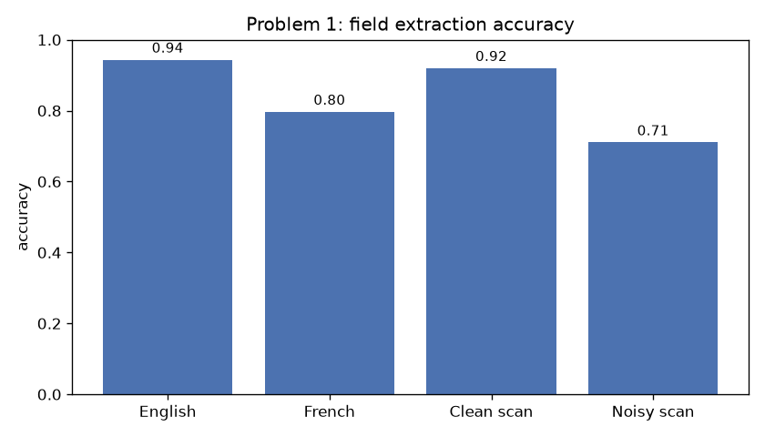
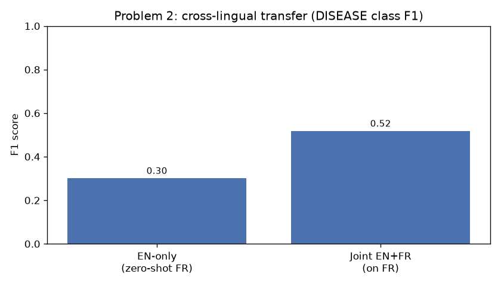
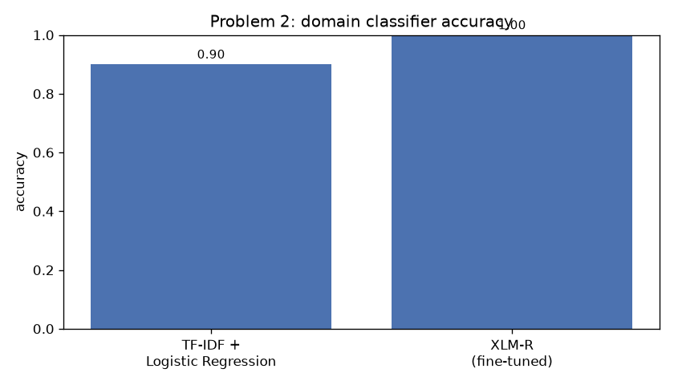
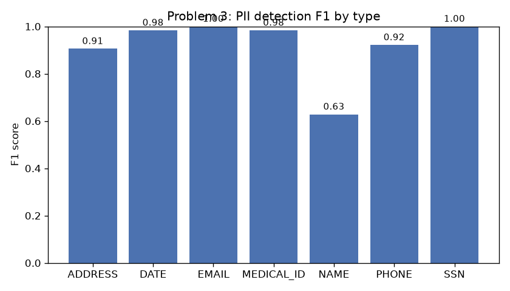
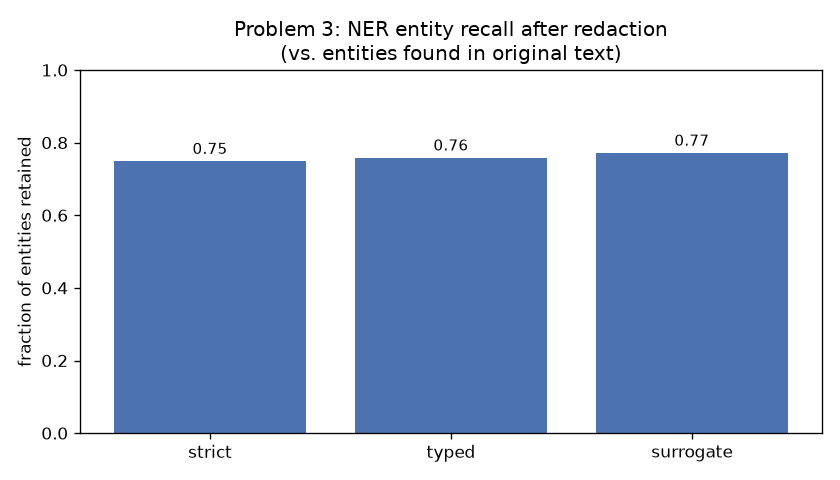

# Results Report

Consolidated metrics and visualizations across all three problems. Detailed write-ups: [architecture.md](architecture.md) (Problem 1), [model_choices.md](model_choices.md) (Problem 2), [error_analysis.md](error_analysis.md) (concrete failure examples), [system_design.md](system_design.md) (Problem 4). Raw numbers live in `outputs/*.json`; charts in `outputs/figures/`.

All models were trained and evaluated on a single RTX 5070 Laptop GPU (8GB VRAM).

## Problem 1 — Document Understanding

LayoutLMv3-base fine-tuned on 160 synthetic EN/FR medical lab reports, evaluated on 80 held out.

- Token-level (training) F1: **0.986**
- Field extraction accuracy: **87.0%**, table cell accuracy: **72.2%**
- Processing time: **0.55s/document**

The English/French gap (94.4% vs. 79.7%) traces mostly to OCR mishandling French accents; the clean/noisy gap (92.0% vs. 71.1%) shows scan rotation is the dominant failure mode, not language. See `docs/architecture.md` for the full breakdown.

## Problem 2 — NER & Classification

**Task A (NER):** XLM-R-base fine-tuned on NCBI Disease (EN) + Quaero French Med (FR), unified into a 10-family label scheme.

Joint EN+FR training nearly doubles zero-shot cross-lingual DISEASE-class F1 (0.301 → 0.518 on French), and also improves in-language English F1 (0.585 → 0.769). Per-entity results vary widely with training support: CHEM (1011 mentions) reaches F1 0.696, while PHEN (77 mentions) and OBJC (84 mentions) score near zero -- a data-volume problem, not a modeling one. Full breakdown: `outputs/problem2_ner_eval.json`.

**Task B (cross-domain classifier):**

XLM-R fine-tuned to 100% test accuracy (vs. 90% for a TF-IDF+LogReg baseline) on Healthcare/Legal/Finance/Multi-domain classification. The task turned out easier than expected because the three source corpora are stylistically very distinct -- see `docs/model_choices.md` for why this should be read as "the pipeline works," not "domain classification is solved." Sample combined classification+entity JSON output: `outputs/problem2_sample_classification_output.json`.

## Problem 3 — Privacy-Preserving Processing (Track A)

**PII detection** (regex for structured PII + spaCy NER for names), evaluated on a 100-document synthetic labeled test set (50 EN + 50 FR):

| Type | Precision | Recall | F1 |
|---|---|---|---|
| EMAIL | 1.000 | 1.000 | 1.000 |
| SSN | 1.000 | 1.000 | 1.000 |
| MEDICAL_ID | 1.000 | 0.968 | 0.984 |
| DATE | 1.000 | 0.968 | 0.984 |
| PHONE | 1.000 | 0.855 | 0.922 |
| ADDRESS | 1.000 | 0.828 | 0.906 |
| NAME | 0.485 | 0.891 | 0.628 |

**Regex vs. model-based trade-offs:** the regex-based detectors (email, phone, SSN, date, medical ID) hit perfect or near-perfect precision -- once a pattern is right, it doesn't produce false positives -- but recall depends entirely on how well the pattern anticipates real-world formatting variance. We hit this directly during development: our first address regex required a recognizable street-type word ("Street", "Ave"), which Faker's generated addresses often don't include, and our French address pattern was accidentally case-sensitive against lowercase street-type words ("rue" vs "Rue") -- both bugs took recall from 1.7% to 82.8% once fixed. This is the core regex weakness: it only catches shapes you thought to write down. Model-based detection (spaCy NER for names) inverts the trade-off: much better recall on open-vocabulary entities like names (89.1%) that no regex could enumerate, but worse precision (48.5%) -- the model confidently mis-tags capitalized boilerplate phrases ("Dossier Medical", "Securite Sociale") and even dates as names, especially at the start of a line (see `docs/error_analysis.md`).

**Handling false positives in medical/legal contexts:** since NAME precision is the weak point and a missed name (false negative) is more harmful than an over-redacted common word (false positive) in a privacy context, the detector is intentionally tuned toward recall for names -- better to occasionally over-redact a template header than to leak a patient's name. One concrete fix applied during this project: running *both* the English and French spaCy models on every document (regardless of actual language) roughly doubled false positives, since a model confidently mis-tags text it wasn't trained on. Adding a simple language guess (`pii_detectors.guess_language`, a stopword-count heuristic) before picking which model to run cut NAME false positives by nearly half.

**Multilingual PII formats:** French and US/English formats differ enough that a single pattern can't cover both -- French SSNs are 15 digits in groups (`2 78 03 75 116 025 43`) vs. US SSNs at 9 digits (`123-45-6789`); French phone numbers use `+33`/`0` prefixes with paired digits vs. US `(555) 123-4567` groupings; French addresses put the street-type word (rue/avenue/boulevard) after the number, US addresses end in a 2-letter state code + ZIP. We run both languages' patterns on every document rather than pre-detecting language for these (unlike names, regex patterns rarely cross-match between formats, so the false-positive cost of running both is low).

**Downstream utility (redaction strategies compared):** the Problem 1 synthetic lab reports (240 documents, all genuinely "healthcare") were redacted with each strategy and re-run through both Problem 2 models.

Domain classification is essentially unaffected by redaction (100% strict/surrogate, 99.6% typed -- one document misclassified). NER entity recall drops more meaningfully: only 74.9-77.2% of the entities found in the original text are still found after redaction, with **surrogate redaction preserving the most utility (77.2%) and strict the least (74.9%)**. This matches expectation: replacing PII with realistic-looking substitute text disturbs the surrounding sentence structure less than an opaque `[REDACTED]`/`[TYPE]` marker, which changes the token context the NER model relies on. Full numbers: `outputs/problem3_downstream_utility.json`.

## Summary

| Problem | Headline metric |
|---|---|
| 1. Document Understanding | 87.0% field extraction accuracy, 0.55s/doc |
| 2A. NER | DISEASE F1 0.518 (FR, joint) / 0.769 (EN, joint) |
| 2B. Classification | 100% accuracy (XLM-R) |
| 3. PII Detection | F1 0.63-1.00 depending on type; NAME is the hard case |
| 3. Downstream Utility | 74.9-77.2% NER entity recall retained after redaction |
