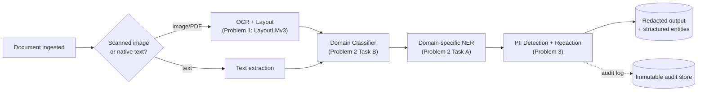

# Problem 4 — System Design: Production Architecture

This document proposes a production design for the pipeline built in Problems 1-3. Where possible, numbers below are the **real measurements** collected while building this project (RTX 5070 Laptop GPU, 8GB VRAM), not estimates -- see `outputs/*.json` for the raw data.

## 4.1 Architecture Design

Pipeline order matters: **classification runs before domain-specific NER** so the right entity schema is applied (a document classified `legal` shouldn't be run through the Healthcare DISEASE/ANAT/CHEM model -- see `docs/model_choices.md` for why this reduces spurious cross-domain false positives). **PII redaction is the last step before anything leaves the secure zone** -- raw, un-redacted text and images never reach downstream storage, analytics, or logs.

**Multi-tenancy:** every request carries a `tenant_id`. Model artifacts are shared (one fine-tuned model serves all tenants of the same sector), but: (a) surrogate-redaction mappings are stored per-tenant and never shared across tenants, (b) audit logs and access policies are tenant-scoped, (c) a tenant can override redaction strictness (e.g. `typed` vs `surrogate`) via per-tenant config without a code change.

## 4.2 GPU Optimization Strategy

- **Batching**: our training used batch size 4 (LayoutLMv3) and 16 (XLM-R) to fit comfortably in 8GB VRAM. A server-grade GPU (24-80GB) would batch far more aggressively; in production, an inference server should queue incoming documents for a few hundred milliseconds and batch whatever arrived, rather than processing one at a time.
- **Mixed precision**: all training in this project used fp16 (`fp16=True`), which is what made ~8-10 minute fine-tuning runs possible on a laptop GPU. The same `torch.autocast` should carry into inference serving.
- **Quantization/distillation**: for high-throughput or CPU-fallback tiers, XLM-R-base (~270M params) and LayoutLMv3-base are both good candidates for dynamic int8 quantization (via ONNX Runtime or `torch.quantization`) or distillation to a smaller multilingual model (e.g. a MiniLM-style student) -- a reasonable trade-off since our own results already show some entity classes (PHEN, OBJC) are data-starved rather than capacity-starved, so a smaller model likely loses little there.
- **Multi-GPU scaling**: these models are small enough (1-2GB in fp16) that the right scaling strategy is **data parallelism across requests** -- multiple model replicas per GPU, load-balanced -- rather than model parallelism. An 8GB card could comfortably host 2-3 concurrent XLM-R replicas.

## 4.3 MLOps & Deployment

- **Model versioning**: every training run in this project already produces a metrics artifact (`train_metrics.json`, `eval_metrics.json`) alongside the checkpoint -- in production this pairing (model weights + the metrics that justified promoting them + the training data version + git commit) is exactly what belongs in a model registry (e.g. MLflow).
- **A/B testing**: route a small percentage of live traffic to a challenger model, compare it against the incumbent on the same evaluation scripts we already have (`evaluate_ner.py`, `evaluate_extraction.py`, `evaluate_redaction.py` become CI regression gates, not just one-off scripts), and promote only on a statistically meaningful improvement.
- **Monitoring**: latency per pipeline stage (we know our own baseline: Problem 1 ≈0.55s/doc, dominated by OCR, not the transformer -- see `docs/architecture.md`); prediction-confidence distributions per model, alerting on drift; PII-detection *rate* per document type over time (a sudden drop suggests a broken regex pattern or a new document format, e.g. exactly the address-regex bug we found and fixed during this project); GPU queue depth and utilization.
- **CI/CD**: on every model-training PR, rerun the relevant `evaluate_*.py` script and block the merge if metrics regress past a threshold; build and push a versioned container image; canary-deploy to a small percentage of traffic before full rollout.
- **Docker**: one lightweight image per serving component (OCR/layout, NER, classifier, PII/redaction), built from a slim PyTorch+CUDA base with only inference-time dependencies (drop `datasets`, keep `transformers`+`torch`+`pytesseract`). Components can be co-located in one process for latency-sensitive paths or split into separate services for independent scaling.

## 4.4 Privacy & Security (Track A)

- **Consistent redaction across millions of documents**: our current `redaction.py` keeps the original→surrogate mapping in memory per call. Production needs a persistent mapping, keyed by a salted one-way hash of the normalized entity text (never the plaintext) per tenant, so "Marie Dubois" always maps to the same surrogate across her entire record set without ever storing a plaintext lookup table.
- **Re-identification risk**: entity-level redaction alone does not prevent re-identification via combinations of quasi-identifiers (e.g. a rare diagnosis + small town + age can still identify someone even with the name removed) -- a real, honest limitation of Track A. Mitigating this fully requires generalization/k-anonymity style checks on the retained fields, which is closer to Track B (differential privacy) territory; Track A's guarantee is "known direct identifiers are removed/replaced," not a formal anonymity guarantee.
- **Data handling**: process raw documents in ephemeral compute; persist only redacted output by default; raw originals (if retained at all) are encrypted at rest, access-logged, and deleted on a defined retention SLA (e.g. GDPR right-to-erasure within 30 days).
- **Audit logging**: every access to a document containing PII is logged (who, when, why) to an immutable, write-once store, with periodic access review.
- **Secure model serving**: mTLS/OAuth2 between internal services, encryption in transit, least-privilege access (most services should only ever see redacted data), and secrets management with no credentials in code or images.

## 4.5 Scalability & Performance

- **Throughput**: Problem 1's measured 0.55s/doc on a single laptop GPU (~1.8 docs/sec) is OCR-bound, not model-bound -- Problem 2's NER/classification inference runs at ~500 sentences/sec on the same GPU (see `eval_runtime` in `outputs/problem2_ner_eval.json`). The practical lever for throughput is therefore parallelizing OCR across CPU workers feeding a batched GPU inference service, not optimizing the transformers further.
- **Latency targets**: for an interactive/sync API, P95 < 2s per document is realistic given the above (OCR ≈0.4-0.5s + NER/classification adds well under 50ms). For large backlogs, prefer an async job queue over synchronous processing -- throughput, not per-document latency, is what matters there.
- **Cost optimization**: keep the GPU tier reserved for the neural components; Problem 3's regex + small spaCy models run comfortably on CPU (no GPU needed at all for PII detection, per our own implementation) -- a meaningful cost saving if deployed as a separate, cheaper service tier. Cache OCR results since documents don't change between reprocessing runs.
- **Failover**: multiple GPU worker replicas behind a durable queue so a crashed worker doesn't drop in-flight documents. Critically, **the privacy path should fail closed**: if the PII/redaction service is unavailable, the pipeline must not release un-redacted documents -- better to queue and retry than to leak.
